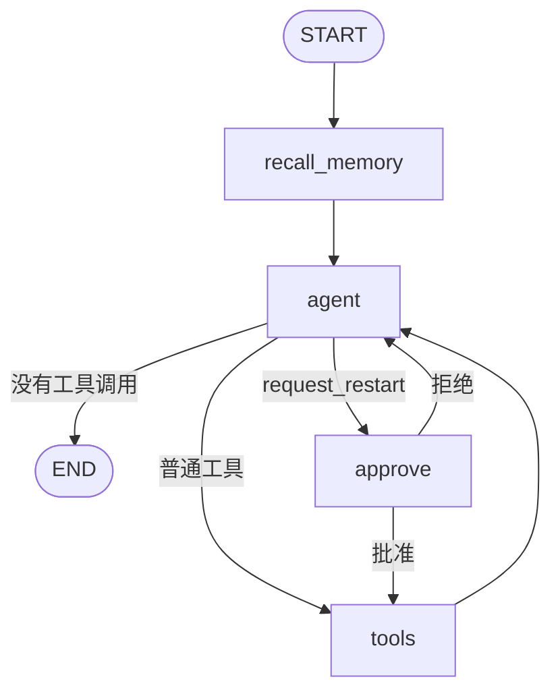
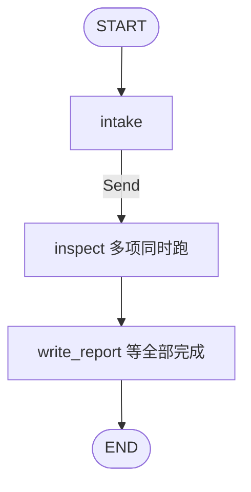

# OnCallAgent

一个用来学习 [LangGraph](https://docs.langchain.com/oss/python/langgraph/graph-api) 的运维助手。一次对话里它会查本地手册、看模拟集群、记住这次会话、记住跨会话的事实，并在重启前停下来等批准。

工具只改内存里的模拟数据，不会执行 shell，也不会连接真实主机。

## 跑起来

```bash
python3 -m venv .venv
source .venv/bin/activate
pip install -e ".[dev]"

python3 -m oncall_agent demo
python3 -m oncall_agent parallel
python3 -m pytest
python3 -m oncall_agent chat --scripted
```

`demo` 用固定剧本走完检索、磁盘检查、短期记忆、长期记忆和重启审批。`parallel` 演示一次告警拆成多项检查同时执行。`chat --scripted` 是对话模式。输入 `exit` 退出；申请重启时会询问 `批准这个操作？[y/N]`。

不设置模型时使用 `KeywordRouterModel`。它按原话选择工具，这样没有 API key 也能看到每个节点的输入输出。图的代码和真实模型相同。换成真实模型：

```bash
pip install -e ".[dev,openai]"
export OPS_AGENT_MODEL=openai:gpt-4o-mini
export OPENAI_API_KEY=sk-...
python3 -m oncall_agent chat
```

`OPS_AGENT_MODEL` 使用 `init_chat_model` 的 `provider:model` 写法。其他供应商需要安装对应的集成包。

## 图



`python3 -m oncall_agent graph` 会打印 LangGraph 自己生成的 mermaid。

| 节点 | 做什么 |
| --- | --- |
| `recall_memory` | 按 `user_id` 从 store 取出长期记忆，写进状态的 `memories` |
| `agent` | 把系统提示、长期记忆和最近消息交给模型；模型可以发起工具调用 |
| `tools` | `ToolNode` 执行模型点名的工具，并把结果追加成 `ToolMessage` |
| `approve` | 调用 `interrupt` 暂停。恢复后才决定放行还是写一条拒绝消息 |

条件边看的是状态，不是写死的下一跳。`route_after_agent` 检查最后一条消息有没有 `tool_calls`，以及工具名是不是 `request_restart`。

## 建议的阅读顺序

1. `src/oncall_agent/state.py`：状态里有什么，哪些字段会合并，哪些会被覆盖。
2. `src/oncall_agent/graph.py`：节点、普通边、条件边、`interrupt`。
3. `src/oncall_agent/tools.py`：工具如何声明，`ToolRuntime` 如何拿到 store。
4. `src/oncall_agent/rag.py`：手册如何切块并放进向量库。
5. `src/oncall_agent/llm.py`：关键词模型怎样模仿「决定调用哪个工具」。
6. `src/oncall_agent/parallel.py`：一次告警如何用 `Send` 并行排查，再汇合写报告。
7. `tests/test_graph.py`：同一条 `thread_id`、两条线程、批准和拒绝分别断言了什么。

## 状态

`OpsState` 继承 `MessagesState`。`messages` 带 `add_messages` reducer：新消息追加，id 相同的消息覆盖。所以调用时只传本轮的用户消息，checkpointer 里已有的历史会合并进来。

`memories` 没有 reducer。`recall_memory` 每次返回整段文本，直接替换上一轮的值。它用 `NotRequired`，是因为调用方不必在输入里带这个字段。

`OpsContext` 是这次运行的上下文，用来放 `user_id`。它不进状态，也不跟某条线程绑死。编译图时通过 `context_schema` 声明，调用时传 `context=OpsContext(user_id="alice")`。

## 工具

工具是普通函数加 `@tool`。模型只看函数名、文档字符串和参数 schema。

`remember` 和 `recall` 需要 store，参数写成 `runtime: ToolRuntime[OpsContext, dict]`。LangGraph 会在执行时注入这个对象，并且不会把它放进给模型的 schema。名字必须叫 `runtime`。测试 `test_runtime_argument_is_hidden_from_model` 锁住了这一点。

安全工具直接进入 `tools`。`request_restart` 先进入 `approve`。拒绝时，`approve` 自己补一条 `ToolMessage`，这样模型仍然能看到「这个工具调用有结果」，图回到 `agent` 后结束。批准时不写消息，条件边把原调用送进 `ToolNode`。

## RAG

手册在 `src/oncall_agent/knowledge/*.md`。`rag.py` 用 `RecursiveCharacterTextSplitter` 切块，再用 `InMemoryVectorStore` 建索引。检索被包成工具 `search_runbooks`，由模型决定要不要查，而不是每句话都先检索。

向量是 `embeddings.py` 里的本地哈希，只对词面重叠敏感，所以手册开头有一行「关键词」。换成真实嵌入时，替换 `LocalHashEmbeddings` 和 `build_store()` 里的 `embed` 即可，图不用改：

```python
from langchain.embeddings import init_embeddings

embeddings = init_embeddings("openai:text-embedding-3-small")
```

`InMemoryStore` 的 `index.embed` 接收 `list[str]`，返回同样长度的向量列表，维度要和 `dims` 一致。

## 两种记忆

短期记忆是 checkpointer。`build_graph` 默认使用 `InMemorySaver`。调用时带上：

```python
config = {"configurable": {"thread_id": "shift"}}
graph.invoke({"messages": [{"role": "user", "content": "我负责 payment-api"}]}, config, context=context)
graph.invoke({"messages": [{"role": "user", "content": "我刚才说我负责哪个服务？"}]}, config, context=context)
```

同一个 `thread_id` 能看见上一轮。换一个 `thread_id` 就看不见。进程退出后 `InMemorySaver` 的内容消失。要落盘可以换成 `langgraph-checkpoint-sqlite` 里的 `SqliteSaver`，编译参数仍然是 `checkpointer=`。

长期记忆是 store，按命名空间 `(user_id, "memories")` 存放。两条线程只要 `user_id` 相同，就能读到同一批事实。`recall_memory` 在每轮一开始运行，所以本轮 `remember` 写下的内容，下一轮才会出现在系统提示里。当前轮仍然能从工具返回的 `ToolMessage` 里看到刚写下去的句子。

## 并行分诊

`src/oncall_agent/parallel.py` 是另一张图，业务是值班分诊。告警原文里点名的服务会同时排查，每个服务有三项检查：日志、资源、手册。



`dispatch` 返回一组 `Send("inspect", 任务)`。任务数量不写死在边上，所以两个服务就是 6 个并行任务。`findings` 使用 `operator.add` 作为 reducer：每个任务只追加自己的一条结果。没有这个 reducer 时，后完成的任务会把先完成的结果盖掉。

`write_report` 注册时带了 `defer=True`。它要等这一步里所有 `inspect` 都结束，再根据完整的 `findings` 写一份报告。

```bash
python3 -m oncall_agent parallel --alert "payment-api 和 order-worker 告警"
```

## 人工审批

`approve` 节点调用 `interrupt({...})`。`invoke` 返回后，`graph.get_state(config).interrupts` 里有待批准的工具名和参数，模拟集群此时还没有被修改。

恢复时不要再传用户消息，传入上次的决定：

```python
from langgraph.types import Command

graph.invoke(Command(resume={"approved": True}), config, context=context)
```

节点会从头再执行，`interrupt(...)` 直接返回 `resume` 的值。拒绝则 `approved` 为 `False`。

## 和预构建 Agent 的关系

LangGraph 1.x 里，`langgraph.prebuilt.create_react_agent` 已让位给 `langchain.agents.create_agent`。那个入口适合工具列表固定、流程就是「模型 ↔ 工具」的情况。

这个项目把图写开，是为了看见四件事：进入模型前可以先跑一个节点、危险工具可以走另一条边、`interrupt` 能把图暂停在节点中间、checkpointer 和 store 是两套存储。这些都看懂之后，再把同类流程收成 `create_agent` 会更容易判断该把逻辑放在中间件还是放在图里。

官方对应材料：

- [Graph API](https://docs.langchain.com/oss/python/langgraph/graph-api)
- [Memory](https://docs.langchain.com/oss/python/langgraph/add-memory)
- [Agentic RAG](https://docs.langchain.com/oss/python/langgraph/agentic-rag)

## 可以接着改的地方

- 给 `fleet.py` 加一个只读工具，并让 `KeywordRouterModel._reply` 在对应说法下返回它的 `tool_calls`。
- 把 `InMemorySaver` 换成 `SqliteSaver`，重启进程后用同一个 `thread_id` 继续聊。
- 在 `tools` 和 `agent` 之间加一个评分节点：手册片段不相关时，改写查询再检索。官方 agentic RAG 教程就是这条路径。
- 把 `LocalHashEmbeddings` 换成 `init_embeddings`，删掉手册里的「关键词」行，看检索是否仍然命中。
